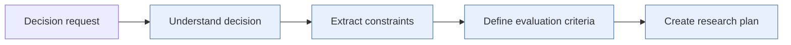
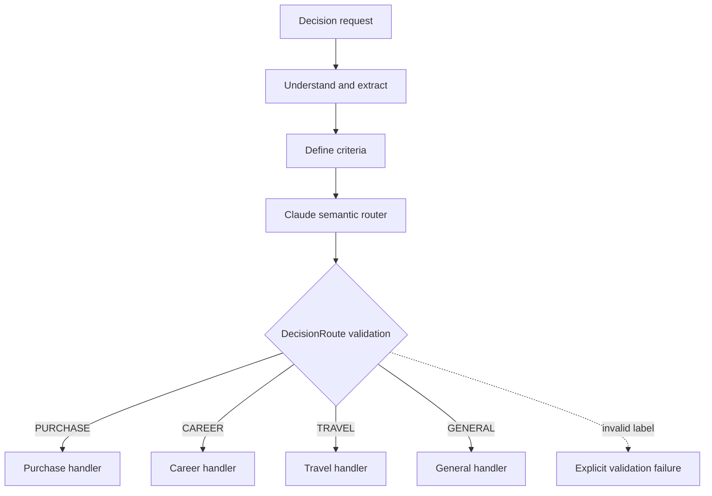
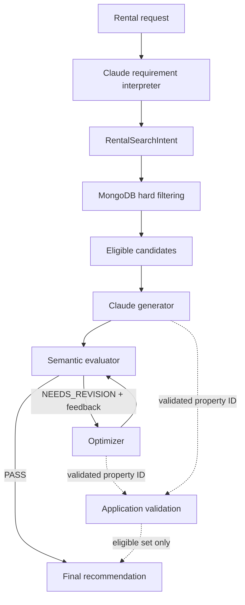

# Workflow Engineering with Claude

A hands-on demonstration of controlled AI workflow patterns using Claude. Application code coordinates model reasoning through predefined execution structures before introducing autonomous agents.

## Workflow patterns

| Pattern | Status |
|---|---|
| Prompt Chaining | ✅ Implemented |
| Routing | ✅ Implemented |
| Parallelization + Aggregation | ✅ Implemented |
| Evaluator–Optimizer | ✅ Implemented |
| Orchestrator–Worker | ⬜ Next |

## 01 — Prompt Chaining

Prompt Chaining decomposes a complex decision into focused, sequential model calls:

```text
Decision request → Understand → Extract constraints
                 → Define criteria → Research plan
```



The implementation demonstrates focused prompts, explicit state propagation, per-stage model configuration, bounded outputs, response/truncation validation, and externalized prompt templates. Application code defines the sequence; Claude reasons within each stage.

## 02 — Routing

Routing adds model-directed branching while keeping execution application-controlled:

```text
Request → Understand → Extract constraints → Define criteria
       → Claude router → DecisionRoute validation → route handler
```



Supported routes are `PURCHASE`, `CAREER`, `TRAVEL`, and `GENERAL`. Claude returns a label; `DecisionRoute` validates it, and Python dispatches to the corresponding predefined handler. Invalid values fail explicitly.

Route handlers emphasize product requirements and ownership (`PURCHASE`), skills and career value (`CAREER`), destination and practical constraints (`TRAVEL`), or general factors, trade-offs, missing information, and next steps (`GENERAL`). Claude selects among allowed capabilities; it cannot create arbitrary paths.

## 03 — Parallelization + Aggregation

This workflow answers a travel-safety question using independent real-world signals: Open-Meteo weather, Open-Meteo air quality, and NASA FIRMS satellite thermal detections.

```text
Request → Claude selects tools → application runs tools concurrently
        → tool_result[] → Claude semantically aggregates → assessment
```

```mermaid
flowchart LR
    A[Travel-safety request] --> B[Claude selects tools]
    B --> W[Weather tool]
    B --> Q[Air-quality tool]
    B --> F[Fire-activity tool]
    W --> WAPI[Open-Meteo]
    Q --> QAPI[Open-Meteo AQ]
    F --> FAPI[NASA FIRMS]
    WAPI --> R[tool_result[]]
    QAPI --> R
    FAPI --> R
    R --> C[Claude semantic aggregation]
    C --> O[Safety assessment]
    W -. concurrent .-> Q
    Q -. concurrent .-> F
```

Claude may return multiple `tool_use` blocks. The application executes synchronous provider calls with `asyncio.to_thread()` and coordinates them with `asyncio.gather()`, then returns matching `tool_result` blocks by `tool_use_id`. Failures use `return_exceptions=True`, allowing Claude to produce a degraded result from available evidence.

The Claude-facing tools hide provider URLs, authentication, geocoding, response formats, caching, and HTTP details. Shared location resolution uses a process-local, normalized-destination cache protected only during writes; network calls occur outside the lock. A cold concurrent request may duplicate geocoding work, an intentional trade-off for this demonstration. FIRMS results are reported as satellite thermal detections, not one wildfire per detection.

The repository retains an Anthropic Tool Runner implementation for comparison, but the explicit runner makes protocol and concurrency responsibilities visible. Parallel execution reduces wall-clock time toward the slowest independent branch; it does not make providers faster.

## 04 — Evaluator–Optimizer

The rental-selection workflow recommends a property from a MongoDB-backed dataset:

```text
Request → requirement interpreter → RentalSearchIntent
        → MongoDB hard filtering → eligible candidates
        → generator → evaluator ── PASS → finish
                              └── NEEDS_REVISION → optimizer → evaluator
```



Claude separates deterministic hard constraints (city, rent, bedrooms, bathrooms, pets, parking, property type) from semantic preferences (safety, space, newness, walkability, schools, transit, amenities, and furnishing). MongoDB determines eligibility; Claude chooses and explains among eligible properties. Unsupported requirements remain visible in the intent.

The generator and optimizer return validated `RentalRecommendationOutput` values, and selected IDs must belong to the eligible set. The evaluator returns `PASS` or `NEEDS_REVISION` with actionable feedback. The application owns the loop and termination; the demo configures `max_optimization_iterations=2`. A passing initial result skips optimization, and repeated rejection stops at the limit—optimization does not guarantee convergence.

## Project organization

```text
src/workflow_engineering/
├── demos/       # runnable demonstrations
├── prompts/     # packaged model instructions
├── tools/       # Claude-facing tools and provider integrations
├── config.py    # environment-backed configuration
├── model.py     # common text-oriented Claude invocation
├── parallelization.py
├── prompt_chain.py
├── prompt_loader.py
└── routing.py
```

Workflow modules own orchestration; prompts define model behavior; tools isolate external services; demos provide inputs and output; tests provide automated verification. The rental workflow and its supporting modules follow the same separation of interpretation, filtering, generation, evaluation, and optimization.

## Model, prompts, and responses

`model.py` centralizes model selection, token limits, thinking configuration, text extraction, and truncation detection for ordinary text calls. Tool workflows use the shared Anthropic client directly to access structured Tool Use and its iterative lifecycle.

Prompts are packaged text resources so model instructions can evolve independently of orchestration. Response handling selects relevant text blocks instead of assuming `response.content[0].text`, joins text content, and checks completion behavior. Tool workflows additionally process `tool_use` and `tool_result` blocks.

## Configuration

Copy `.env.example` to `.env` and provide local credentials/configuration as needed. Common settings include:

```text
ANTHROPIC_API_KEY
OPEN_METEO_GEOCODING_URL
OPEN_METEO_FORECAST_URL
OPEN_METEO_AIR_QUALITY_URL
NASA_FIRMS_MAP_KEY
NASA_FIRMS_AREA_API_URL
NASA_FIRMS_SOURCE
EXTERNAL_API_TIMEOUT_SECONDS
MONGODB_URI
MONGODB_DATABASE
MONGODB_PROPERTIES_COLLECTION
```

Credentials belong only in `.env`; application code reads them through the configuration layer.

## Running demonstrations

From the repository root:

```bash
uv run --project projects/workflow-engineering python -m workflow_engineering.demos.prompt_chaining_demo
uv run --project projects/workflow-engineering python -m workflow_engineering.demos.routing_demo
uv run --project projects/workflow-engineering python -m workflow_engineering.demos.parallel_travel_demo
uv run --project projects/workflow-engineering python -m workflow_engineering.demos.rental_selection_demo
```

The routing input can be changed to observe `PURCHASE`, `CAREER`, `TRAVEL`, and `GENERAL`. The parallelization demo makes live external API calls; the rental demo requires the MongoDB settings above.

## Validation

```bash
uv run pytest -q
uv run ruff check projects/workflow-engineering
uv run pyright projects/workflow-engineering
```

Tests cover workflow behavior and static correctness. The runnable demonstrations exercise live model behavior for Prompt Chaining, Routing, and Parallelization + Aggregation.

## Current boundary and next step

```text
Prompt Chaining               predefined sequence
Routing                       model-selected predefined branch
Parallelization + Aggregation model-selected capabilities + app concurrency
Evaluator–Optimizer           model evaluation + bounded feedback refinement
```

The project intentionally does not yet introduce autonomous loops, persistent memory, multi-agent coordination, arbitrary model-directed execution, or a custom agent harness. Claude performs reasoning within application-owned boundaries; the next pattern, Orchestrator–Worker, will explore dynamic task decomposition and delegation while retaining explicit execution control.
